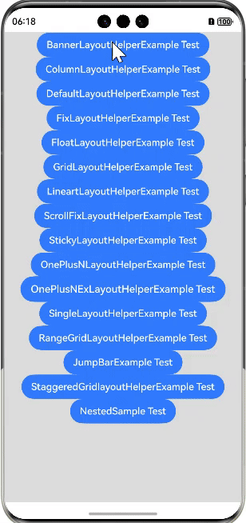
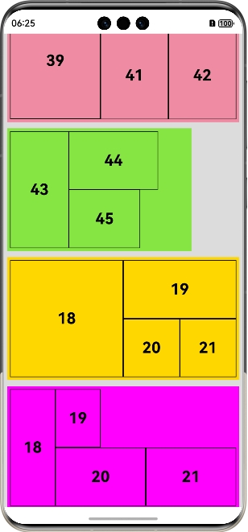

<div align="center">
<h1>vlayout4cj</h1>
</div>

<p align="center">


</p>

## 介绍 

vlayout4cj 能够处理列表、网格和其它布局在同一个视图的复杂情况，使用者可以使用已设定好的容器布局组件，也可以在此基础上自定义容器布局组件。

## 效果展示

<p align="left">

</p>
  
## 特性

- BANNER_LAYOUT 滑动容器布局组件
- COLUMN_LAYOUT 栏格容器布局组件
- DEFAULT_LAYOUT 默认容器布局组件
- FIX_LAYOUT 固定容器布局组件
- FLOAT_LAYOUT 浮动容器布局组件
- GRID_LAYOUT 复杂网格容器布局组件
- LINEAR_LAYOUT 列表容器布局组件
- ONEN_LAYOUT 一拖N容器布局组件
- ONEN_EX_LAYOUT 一拖N拓展容器布局组件
- RANGEGRID_LAYOUT 区域网格容器布局组件
- SCROLL_FIX_LAYOUT 滚动固定容器布局组件
- SINGLE_LAYOUT 通栏容器布局组件
- STAGGEREDGRID_LAYOUT 交错网格容器布局组件
- STICKY_LAYOUT 吸顶容器布局组件
- 跳转 item 项位置

### 源码目录

```shell
├─ AppScope
├─ doc                   # API文档和使用手册存放目录                   
├─ entry                 # 示例代码文件夹
├─ hvigor                # 构建工具目录              
├─ vlayout               # vlayout 库源目录                  
│  └─ src
│      └─ main
│          ├─ cangjie    # vlayout 源码     
│          └─ resources  # 资源文件
└─ README.md             # vlayout4cj 介绍及使用说明
```
## 接口说明

主要类和函数接口说明详见 [API](doc/feature_api.md)

## 使用说明

1. 通过 module 引入
    1. 克隆下载项目
    2. 将 vlayout 模块拷贝到应用项目下
    3. 修改自身应用 entry/src/main/cangjie 下的 cjpm.toml 文件，在 [dependencies] 字段下添加:
    
        ```toml
       [dependencies]
            [dependencies.vlayout4cj]
                 path = "../../../../vlayout/src/main/cangjie"
       ```
    4. 在项目中使用 import vlayout4cj.* 引用 vlayout 项目
       ```cangjie
       import vlayout4cj.*
       ```
2. 把 vlayout4cj 作为三方库依赖引入
    1. 目标工程把 vlayout4cj 依赖库作为 git submodule 引入

    ```
    > cd $工程根目录
    > mkdir third-party
    > cd third-party
    > git submodule add "https://gitcode.com/Cangjie-TPC/vlayout4cj"
    ```
    2. 修改自身应用 entry/src/main/cangjie 下的 cjpm.toml 文件，添加依赖
   ```toml
    [dependencies]
        [dependencies.highlightguide]
            path = "../../../../third-party/vlayout4cj/vlayout/src/main/cangjie"
            version = "1.0.0"
   ```
    3. 在项目中使用 vlayout 组件
       ```cangjie
       import vlayout4cj.*
       ```

## 功能示例

详见 `entry`

#### ONEN_LAYOUT 一拖N容器布局组件

```cangjie
import ohos.state_macro_manage.*
import ohos.base.*
import ohos.component.*
import ohos.state_manage.*
import vlayout4cj.*

@Entry
@Component
class OnePlusNLayoutHelperExample {
    private  var vScroller: Scroller = Scroller()

    @Builder func onenLayoutContent(item: layoutDataType) {
        Text("${item.layoutText}")
            .width(100.percent)
            .height(100.percent)
            .border(width: 1.vp, color: Color.BLACK, radius: 0.vp, style: BorderStyle.Solid )
            .fontSize(25)
            .fontColor(Color.BLACK)
            .fontWeight(FontWeight.Bold)
            .textAlign(TextAlign.Center)
            .textOverflow(TextOverflow.Ellipsis)

    }


    func build() {
        Column(){
            List(scroller: vScroller) {
                ListItem() {
                    OneLayout(
                        vLayoutContent: this.onenLayoutContent,
                        vLayoutData: [
                            layoutDataType(layoutText: "18")
                            ],
                        vLayoutAttribute: AbstractFullFillAttributes(
                            layoutWidth: 100.percent,
                            layoutHeight: 200.0.vp,
                            bgColor: 0xff87e543,
                            margin: [5.0, 5.0, 5.0, 5.0],
                            padding:[5.0, 5.0, 5.0, 5.0]
                        )
                    )
                }

                ListItem() {
                    OneLayout(
                        vLayoutContent: this.onenLayoutContent,
                        vLayoutData: [
                            layoutDataType(layoutText: "19")
                            ],
                        vLayoutAttribute: AbstractFullFillAttributes(
                            layoutWidth: 200.0.vp,
                            layoutHeight: 200.0.vp,
                            bgColor: 0xba55d3,
                            margin: [5.0, 5.0, 5.0, 5.0],
                            padding:[5.0, 5.0, 5.0, 5.0]
                        )
                    )
                }

                ListItem() {
                    OneLayout(
                        vLayoutContent: this.onenLayoutContent,
                        vLayoutData: [
                            layoutDataType(layoutText: "18")
                            ],
                        vLayoutAttribute: AbstractFullFillAttributes(
                            layoutWidth: 100.percent,
                            layoutHeight: 200.0.vp,
                            bgColor: 0x808000,
                            margin: [5.0, 5.0, 5.0, 5.0],
                            padding:[5.0, 5.0, 5.0, 5.0]
                        )
                    )
                }

                ListItem() {
                    OneLayout(
                        vLayoutContent: this.onenLayoutContent,
                        vLayoutData: [
                            layoutDataType(layoutText: "37"),
                            layoutDataType(layoutText: "38")
                            ],
                        vLayoutAttribute: AbstractFullFillAttributes(
                            layoutWidth: 100.percent,
                            layoutHeight: 120.0.vp,
                            colWeights: [40.0, 45.0],
                            bgColor: 0xff876384,
                            margin: [5.0, 5.0, 5.0, 5.0],
                            padding:[5.0, 5.0, 5.0, 5.0]
                        )
                    )
                }

                ListItem() {
                    OneLayout(
                        vLayoutContent: this.onenLayoutContent,
                        vLayoutData: [
                            layoutDataType(layoutText: "39"),
                            layoutDataType(layoutText: "40"),
                            layoutDataType(layoutText: "41"),
                            layoutDataType(layoutText: "42")
                            ],
                        vLayoutAttribute: AbstractFullFillAttributes(
                            layoutWidth: 100.percent,
                            layoutHeight: 200.0.vp,
                            rowWeights: [10.0, 30.0],
                            colWeights: [40.0, 60.0, 30.0, 30.0],
                            bgColor: 0xffef8ba3,
                            margin: [5.0, 5.0, 5.0, 5.0],
                            padding:[5.0, 5.0, 5.0, 5.0]
                        )
                    )
                }

                ListItem() {
                    OneLayout(
                        vLayoutContent: this.onenLayoutContent,
                        vLayoutData: [
                            layoutDataType(layoutText: "43"),
                            layoutDataType(layoutText: "44"),
                            layoutDataType(layoutText: "45")
                            ],
                        vLayoutAttribute: AbstractFullFillAttributes(
                            layoutHeight: 200.0.vp,
                            layoutWidth: 300.0.vp,
                            bgColor: 0xff87e543,
                            colWeights: [33.0, 50.0, 40.0],
                            margin: [5.0, 5.0, 5.0, 5.0],
                            padding:[5.0, 5.0, 5.0, 5.0]
                        )
                    )
                }

                ListItem() {
                    OneLayout(
                        vLayoutContent: this.onenLayoutContent,
                        vLayoutData: [
                            layoutDataType(layoutText: "18"),
                            layoutDataType(layoutText: "19"),
                            layoutDataType(layoutText: "20"),
                            layoutDataType(layoutText: "21")
                            ],
                        vLayoutAttribute: AbstractFullFillAttributes(
                            layoutWidth: 100.percent,
                            layoutHeight: 200.0.vp,
                            bgColor: 0xffd700,
                            rowWeights: [20.0, 20.0],
                            margin: [5.0, 5.0, 5.0, 5.0],
                            padding:[5.0, 5.0, 5.0, 5.0]
                        )
                    )
                }

                ListItem() {
                    OneLayout(
                        vLayoutContent: this.onenLayoutContent,
                        vLayoutData: [
                            layoutDataType(layoutText: "18"),
                            layoutDataType(layoutText: "19"),
                            layoutDataType(layoutText: "20"),
                            layoutDataType(layoutText: "21")
                            ],
                        vLayoutAttribute: AbstractFullFillAttributes(
                            layoutWidth: 100.percent,
                            layoutHeight: 200.0.vp,
                            bgColor: 0xff00ff,
                            colWeights: [20.0, 20.0],
                            margin: [5.0, 5.0, 5.0, 5.0],
                            padding:[5.0, 5.0, 5.0, 5.0]
                        )
                    )
                }

                ListItem() {
                    OneLayout(
                        vLayoutContent: this.onenLayoutContent,
                        vLayoutData: [
                            layoutDataType(layoutText: "18"),
                            layoutDataType(layoutText: "19"),
                            layoutDataType(layoutText: "20"),
                            layoutDataType(layoutText: "21"),
                            layoutDataType(layoutText: "22")
                            ],
                        vLayoutAttribute: AbstractFullFillAttributes(
                            layoutWidth: 100.percent,
                            layoutHeight: 200.0.vp,
                            bgColor: 0xffb6c1,
                            rowWeights: [20.0, 20.0],
                            colWeights: [40.0, 20.0],
                            margin: [5.0, 5.0, 5.0, 5.0],
                            padding:[5.0, 5.0, 5.0, 5.0],
                            hasFooter: true,
                            hasHeader: true
                        )
                    )
                }

                ListItem() {
                    OneLayout(
                        vLayoutContent: this.onenLayoutContent,
                        vLayoutData: [
                            layoutDataType(layoutText: "18"),
                            layoutDataType(layoutText: "19"),
                            layoutDataType(layoutText: "20"),
                            layoutDataType(layoutText: "21"),
                            layoutDataType(layoutText: "22"),
                            layoutDataType(layoutText: "23")
                            ],
                        vLayoutAttribute: AbstractFullFillAttributes(
                            layoutWidth: 100.percent,
                            layoutHeight: 200.0.vp,
                            bgColor: 0xff0000,
                            margin: [5.0, 5.0, 5.0, 5.0],
                            padding:[5.0, 5.0, 5.0, 5.0]
                        )
                    )
                }

            }
        }
        .width(100.percent)
        .height(100.percent)
        .backgroundColor(0xDCDCDC)
    }
}
```
效果图如下：

<p align="left">

</p>

## 约束与限制

在下述版本验证通过：

    DevEco Studio 5.1.0.828SP1
    Cangjie Support Plugin 5.1.0.828

## 开源协议

本项目基于 [MIT](./LICENSE)，请自由的享受和参与开源。

## 参与贡献

欢迎给我们提交 PR，欢迎给我们提交 Issue，欢迎参与任何形式的贡献。
